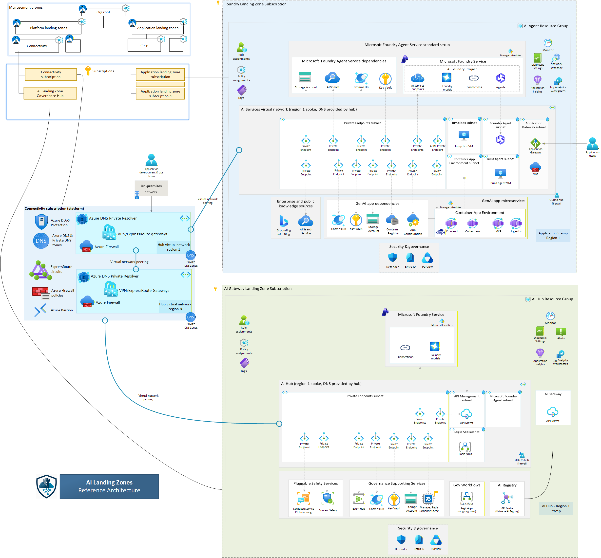

# Landing Zone de IA en Azure



Este repositorio contiene **código propio** para desplegar la base de la landing zone de IA. El producto principal ya no es una carpeta `upstream`, sino despliegues autocontenidos:

- [infra/hub-governance](/Users/unidentified/Documents/Landing%20Zone/infra/hub-governance/README.md)
- [infra/spoke-base](/Users/unidentified/Documents/Landing%20Zone/infra/spoke-base/README.md)

## Patrón Foundry Agent

La rama `foundry-agent` contiene la [base privada de Foundry Standard](infra/foundry-private/README.md),
con frontend y backend en Container Apps, Application Gateway privado con WAF,
ACR, Key Vault y persistencia dentro de CAF.

Esta base es común para agentes **con o sin RAG**. No se mantiene una rama
`foundry-rag` separada: la recuperación documental se configura sobre esta misma
infraestructura. Search es una dependencia de Foundry Standard; los índices de
aplicación, ingestión, embeddings y herramientas de recuperación se agregan según
el workload. La plantilla actual no implementa esa capa RAG.

El desarrollo de este patrón se realiza en un worktree de `foundry-agent`; la
publicación de la rama no implica un despliegue en Azure.

## Objetivo

Dejar lista una base aprobable por Infraestructura para un patrón `hub-hubs`:

- un **hub corporativo de conectividad** gestionado por plataforma;
- un **hub de gobernanza de IA** con APIM, AI Foundry y observabilidad;
- **spokes base** por POC o solución, desplegables incluso por suscripción.

## Estructura

```text
.
├── infra/
│   ├── hub-governance/
│   ├── spoke-base/
│   └── foundry-private/
├── environments/
│   ├── hub-governance/
│   └── spoke-base/
├── scripts/
│   ├── deploy-hub-governance.sh
│   ├── deploy-spoke-base.sh
│   └── show-upstream-versions.sh
└── references/
    └── upstream-sources.json
```

## Qué despliega cada carpeta

### `infra/hub-governance`

- VNet del hub de gobernanza
- API Management
- AI Foundry / AI Services
- Log Analytics y Application Insights
- Key Vault, Storage, Event Hub y Cosmos DB
- Private DNS Zones y private endpoints opcionales

### `infra/spoke-base`

- VNet del spoke
- AI Foundry / AI Services
- Log Analytics y Application Insights
- Storage y Key Vault
- AI Search opcional
- Cosmos DB opcional
- ACR opcional
- route table opcional hacia firewall del hub
- peering spoke → hub opcional
- Private DNS Zones y private endpoints opcionales

## Principios de diseño

1. El producto principal del repo es **nuestro código Bicep**.
2. Cada despliegue tiene **sus propios módulos locales**.
3. No hay librería compartida entre hub y spoke en esta primera versión.
4. Los repositorios de Microsoft quedan solo como **referencia y trazabilidad**.

## Despliegue

### Hub de gobernanza

```bash
cp environments/hub-governance/hub-governance.env.example environments/hub-governance/hub-governance.env
./scripts/deploy-hub-governance.sh environments/hub-governance/hub-governance.env create
```

### Spoke base

```bash
cp environments/spoke-base/spoke-base.env.example environments/spoke-base/spoke-base.env
./scripts/deploy-spoke-base.sh environments/spoke-base/spoke-base.env create
```

Ambos scripts soportan:

- `create`
- `what-if`
- `validate`

## Lo que sí y no hace esta versión

### Sí

- despliega un hub propio;
- despliega un spoke base propio;
- permite múltiples spokes por POC o suscripción;
- compila localmente con Bicep;
- deja la evolución abierta a patrones posteriores.

### No todavía

- no despliega el connectivity hub corporativo;
- no automatiza el peering inverso `hub → spoke`;
- no configura todavía la ingestión ni la recuperación documental RAG.

## Qué debe revisar Infra primero

1. CIDRs y segmentación de red.
2. Ownership de DNS privado.
3. Ownership del firewall y de las route tables.
4. Exposición final de APIM.
5. Suscripciones por spoke/POC.
6. Cuotas y regiones de AI Foundry.

## Documentación adicional

- [docs/orden-despliegue.md](/Users/unidentified/Documents/Landing%20Zone/docs/orden-despliegue.md)
- [docs/decisiones-y-supuestos.md](/Users/unidentified/Documents/Landing%20Zone/docs/decisiones-y-supuestos.md)
- [docs/migracion-desde-gpt-rag.md](/Users/unidentified/Documents/Landing%20Zone/docs/migracion-desde-gpt-rag.md)

## Referencias

La trazabilidad a los repos de referencia se mantiene en:

- [references/upstream-sources.json](/Users/unidentified/Documents/Landing%20Zone/references/upstream-sources.json)
