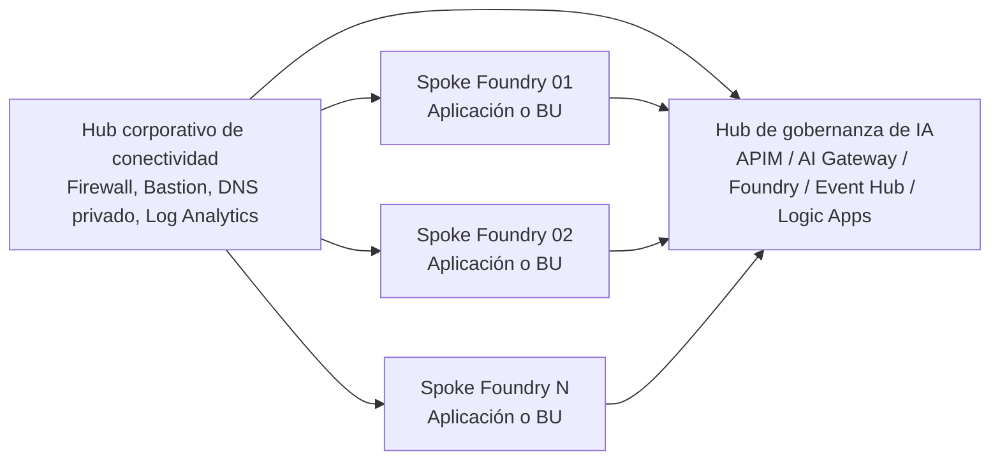

# Landing Zone de IA en Azure para patrón Hub-Hubs

Este repositorio consolida en un solo lugar el código y la documentación necesarios para evaluar, desplegar y presentar a Infraestructura una arquitectura de **Landing Zone de IA en Azure** basada en:

- un **hub corporativo de conectividad** existente o gestionado por la plataforma;
- un **hub de gobernanza de IA** con **API Management / AI Gateway**;
- uno o varios **spokes de Azure AI Foundry** para cargas por unidad de negocio o caso de uso;
- conectividad privada, DNS privado centralizado, UDR hacia firewall y observabilidad reutilizable.

La intención es reemplazar el enfoque actual, más cercano a un despliegue único de solución, por un patrón **hub-hubs** que se alinea mejor con gobierno centralizado, segmentación de red y escalabilidad organizacional.

## Objetivo

El objetivo de este repo es dejar lista una base técnica que permita:

1. revisar con Infraestructura la topología objetivo;
2. demostrar que el patrón se puede desplegar con IaC;
3. mantener trazabilidad hacia los repositorios oficiales de Microsoft;
4. separar claramente el **hub de gobernanza** del **spoke de Foundry**;
5. documentar en español la migración desde el estado actual basado en `GPT-RAG`.

## Qué incluye este repositorio

Este repo no reescribe desde cero los aceleradores de Microsoft. En su lugar:

- **vende** el código upstream necesario en `upstream/`;
- **pinea** commits concretos para revisión y repetibilidad;
- añade una **capa propia** de documentación, ejemplos de entorno y scripts de ejecución;
- deja una guía clara para el patrón **hub-hubs**.

## Repositorios de origen y versiones fijadas

Los siguientes repos se tomaron como base y quedaron referenciados en `references/upstream-sources.json`:

| Repositorio | Rol en esta solución | Ref fijada |
| --- | --- | --- |
| `Azure/AI-Landing-Zones` | referencia arquitectónica combinada Foundry + APIM | `7ba10daab2036f8b7c4bf03c9fc0034817443fbd` |
| `Azure/bicep-ptn-aiml-landing-zone` | spoke de Azure AI Foundry / AI Landing Zone | `fb2f85074eb849be7df4109e516b9902b1f84fa6` |
| `Azure-Samples/ai-hub-gateway-solution-accelerator` (`citadel-v1`) | hub de gobernanza con APIM / AI Gateway | `f2702b49f80d0ad40e227ae2ee9d8b6dd9137da4` |
| `Azure/GPT-RAG` (`release/2.3.0`) | estado actual de referencia para comparación | `719d69e4bfdb9dc672a24ac89ba19a9b4eead603` |

## Arquitectura objetivo

La interpretación operativa de “hub-hubs” para este repo es la siguiente:

- **Hub 1: Connectivity Hub**
  - Firewall corporativo
  - Bastion corporativo
  - Private DNS Zones compartidas
  - Log Analytics centralizado
  - conectividad hacia on-premises / ExpressRoute / VPN
- **Hub 2: AI Governance Hub**
  - Azure API Management como AI Gateway
  - Microsoft Foundry para catálogo, conexiones y gobierno
  - Event Hub / Logic Apps / Cosmos DB para ingestión y observabilidad
  - publicación de contratos de acceso
- **Spokes de AI Foundry**
  - una landing zone por dominio, BU o caso de uso
  - servicios privados por VNet
  - peering hacia el hub corporativo
  - consumo del AI Gateway como plano de gobernanza



## Diferencia frente al estado actual (`GPT-RAG`)

El estado actual basado en `GPT-RAG` sirve bien como acelerador de solución RAG, pero no es el mejor punto de partida para el patrón organizacional que se quiere aprobar.

### Lo que `GPT-RAG` resuelve bien

- solución aceleradora para RAG empresarial;
- red Zero Trust para un despliegue concreto;
- dependencias típicas de una app GenAI;
- base útil para una sola implementación.

### Lo que no resuelve completamente para este caso

- separación explícita entre **gobierno central** y **workloads por spoke**;
- patrón de **AI Gateway** común para varios spokes;
- onboarding estandarizado por contratos de acceso/publicación;
- revisión de Infra enfocada en topología **hub-hubs**;
- escalado organizacional con una landing zone por dominio o caso de uso.

### Qué cambia con esta propuesta

- `GPT-RAG` deja de ser el molde principal;
- el **spoke** se toma de `bicep-ptn-aiml-landing-zone`;
- el **hub de gobernanza** se toma de `ai-hub-gateway-solution-accelerator`;
- la arquitectura compuesta se alinea con `AI-Landing-Zones`.

La comparación detallada quedó en [docs/migracion-desde-gpt-rag.md](docs/migracion-desde-gpt-rag.md).

## Estructura del repositorio

```text
.
├── README.md
├── docs/
│   ├── migracion-desde-gpt-rag.md
│   ├── orden-despliegue.md
│   └── decisiones-y-supuestos.md
├── environments/
│   ├── citadel-hub/
│   │   ├── README.md
│   │   └── citadel-hub.env.example
│   └── foundry-spoke/
│       ├── README.md
│       └── foundry-spoke.env.example
├── references/
│   └── upstream-sources.json
├── scripts/
│   ├── azd-citadel-hub.sh
│   ├── azd-foundry-spoke.sh
│   └── show-upstream-versions.sh
└── upstream/
    ├── AI-Landing-Zones/
    ├── ai-hub-gateway-solution-accelerator/
    └── bicep-ptn-aiml-landing-zone/
```

## Qué se debe revisar primero con Infraestructura

Antes de ejecutar despliegues, el equipo de infraestructura debe validar estas decisiones:

1. **Suscripciones**
   - cuál aloja el hub corporativo;
   - cuál aloja el hub de gobernanza;
   - cuáles alojan los spokes de Foundry.
2. **Direccionamiento**
   - rangos CIDR del hub de gobernanza;
   - rangos CIDR de los spokes;
   - ausencia de solapamiento con on-premises y redes existentes.
3. **DNS privado**
   - si las zonas privadas las crea cada despliegue o se reutilizan desde el hub;
   - quién es dueño de los links VNet y del naming.
4. **Ruteo**
   - si el spoke enviará `0.0.0.0/0` al firewall del hub;
   - si la tabla de rutas la crea la landing zone o la entrega el equipo de plataforma.
5. **Bastion**
   - si el spoke de Foundry reutiliza Bastion corporativo;
   - si se evita Bastion dedicado en cada spoke.
6. **Observabilidad**
   - si Log Analytics y Application Insights se centralizan o no.
7. **Exposición APIM**
   - si APIM será `Internal` para producción;
   - si habrá private endpoint y dominios privados/públicos.
8. **Seguridad**
   - políticas de egress;
   - RBAC de despliegue;
   - servicios obligatorios como Defender, Purview o Policy.

## Orden recomendado de despliegue

La secuencia recomendada para probar el patrón completo es:

1. **Preparar o confirmar el Connectivity Hub**
   - VNet hub
   - Firewall
   - Bastion
   - Private DNS Zones
   - Log Analytics compartido
2. **Desplegar el AI Governance Hub**
   - basado en `upstream/ai-hub-gateway-solution-accelerator`
   - con VNet propia o integrada al hub según decisión
3. **Desplegar el primer Foundry Spoke**
   - basado en `upstream/bicep-ptn-aiml-landing-zone`
   - con `deploymentMode=ailz-integrated`
4. **Completar peerings y DNS**
   - spoke → hub
   - hub → spoke
   - links a zonas privadas
5. **Validar acceso y flujo**
   - resolución DNS privada
   - reachability desde jumpbox
   - acceso a servicios vía private endpoints
   - conexión spoke → AI Gateway

La guía más puntual quedó en [docs/orden-despliegue.md](docs/orden-despliegue.md).

## Artefactos principales de despliegue

### 1. Spoke de Foundry

Ruta:

`upstream/bicep-ptn-aiml-landing-zone`

Uso esperado:

- `azd provision`
- `deploymentMode=ailz-integrated`
- reutilización opcional de:
  - hub VNet
  - Bastion
  - Log Analytics
  - Private DNS Zones
  - route table

Parámetros clave para este caso:

- `DEPLOYMENT_MODE=ailz-integrated`
- `NETWORK_ISOLATION=true`
- `HUB_INTEGRATION_HUB_VNET_RESOURCE_ID`
- `EXISTING_LOG_ANALYTICS_WORKSPACE_RESOURCE_ID`
- `EXISTING_BASTION_RESOURCE_ID`
- `HUB_INTEGRATION_EGRESS_NEXT_HOP_IP`
- `HUB_INTEGRATION_EXISTING_ROUTE_TABLE_RESOURCE_ID`

### 2. Hub de gobernanza

Ruta:

`upstream/ai-hub-gateway-solution-accelerator`

Uso esperado:

- `azd provision` si se quiere validar solo IaC;
- `azd up` si se quiere incluir también el despliegue del componente de ingestión.

Parámetros clave para este caso:

- `USE_EXISTING_VNET`
- `USE_EXISTING_LOG_ANALYTICS`
- `APIM_NETWORK_TYPE`
- `APIM_V2_USE_PRIVATE_ENDPOINT`
- `AI_FOUNDRY_EXTERNAL_NETWORK_ACCESS`
- `FOUNDRY_NETWORK_INJECTION_ENABLED`
- `ENABLE_UNIFIED_AI_API`
- `ENABLE_API_CENTER`

## Guía rápida de uso

### Prerrequisitos

- Azure CLI
- Azure Developer CLI (`azd`)
- permisos `Contributor` y `User Access Administrator`
- providers registrados en la suscripción destino

### Ver commits fijados

```bash
./scripts/show-upstream-versions.sh
```

### Preparar variables de ejemplo

```bash
cp environments/citadel-hub/citadel-hub.env.example environments/citadel-hub/citadel-hub.env
cp environments/foundry-spoke/foundry-spoke.env.example environments/foundry-spoke/foundry-spoke.env
```

### Desplegar el hub de gobernanza

```bash
./scripts/azd-citadel-hub.sh environments/citadel-hub/citadel-hub.env provision
```

Si se requiere desplegar también el proyecto `usage-ingestion-logicapp`:

```bash
./scripts/azd-citadel-hub.sh environments/citadel-hub/citadel-hub.env up
```

### Desplegar el spoke de Foundry

```bash
./scripts/azd-foundry-spoke.sh environments/foundry-spoke/foundry-spoke.env provision
```

## Recomendación para la revisión de Infraestructura

Para una revisión ejecutiva y técnica ordenada, sugeriría presentar esto en tres capas:

1. **Arquitectura**
   - revisar `upstream/AI-Landing-Zones/README.md`
   - usar este `README.md` como interpretación local del patrón
2. **Hub de gobernanza**
   - revisar `upstream/ai-hub-gateway-solution-accelerator/README.md`
   - validar si el hub será parte del hub existente o un spoke dedicado
3. **Spoke Foundry**
   - revisar `upstream/bicep-ptn-aiml-landing-zone/docs/runbook-hub-spoke.md`
   - confirmar el modo `ailz-integrated`

## Supuestos de esta primera versión

- el hub corporativo de conectividad ya existe o será provisto por otro equipo;
- este repo se enfoca en preparar el **hub de gobernanza de IA** y el **primer spoke de Foundry**;
- la conexión entre ambos y el hub corporativo se resuelve con **VNet peering + DNS privado + UDR**;
- no se está migrando automáticamente una implementación productiva existente de `GPT-RAG`;
- este repo está orientado a **evaluación de arquitectura y preparación de despliegue**, no a cutover inmediato.

Los supuestos y decisiones abiertas están documentados en [docs/decisiones-y-supuestos.md](docs/decisiones-y-supuestos.md).

## Siguiente paso sugerido

Una vez que Infra confirme el patrón, lo razonable es:

1. cerrar naming, CIDRs y ownership de DNS;
2. definir parámetros por ambiente (`dev`, `nonprod`, `prod`);
3. automatizar el despliegue con CI/CD sobre este mismo repo;
4. crear el segundo spoke como plantilla repetible para otras BUs o casos de uso.
